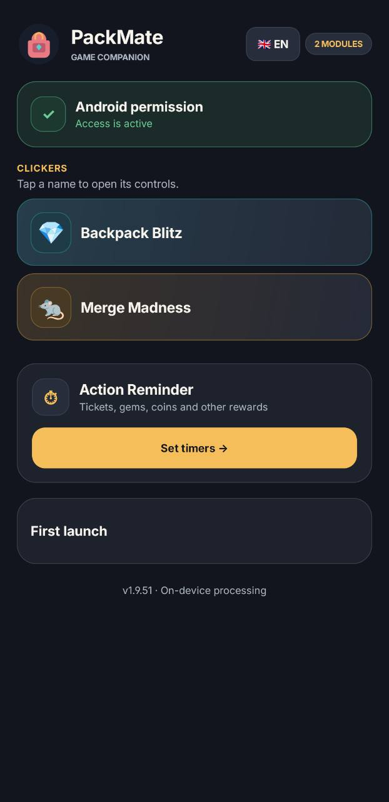
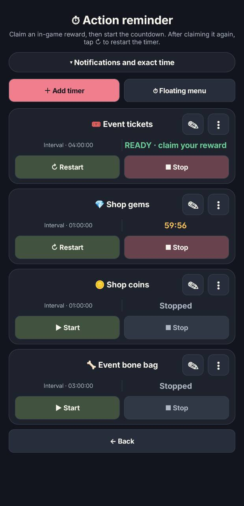
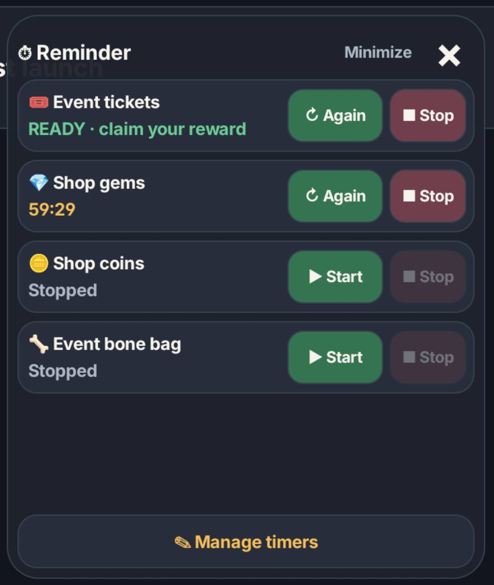
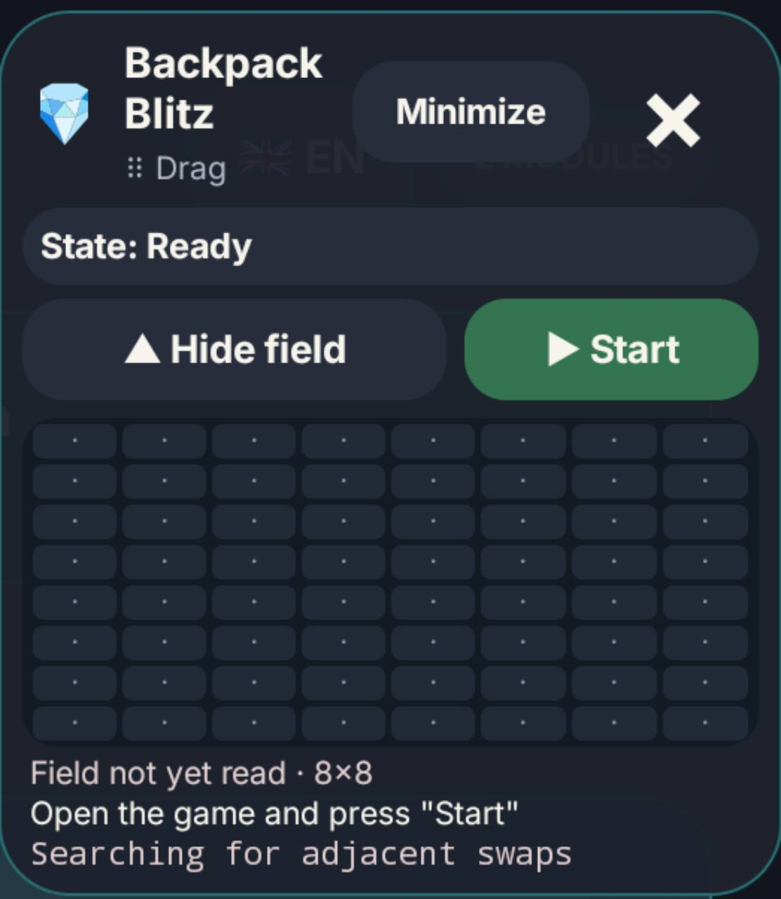

<h1>🎒 PackMate</h1>

<strong>An offline, unofficial Android companion for Backpack Brawl minigames.</strong>

  
   
  
   
  

<em>On-device board recognition · Compact floating controls · Reward reminders</em>

> PackMate is an independent community project. It is not affiliated with or endorsed by the game developers.

View app screenshots

<em>Preview captures from version 1.9.51; the timer cards and floating timer panel have since been made more compact.</em>

<table>
<tr>
<td align="center"><strong>Main screen</strong> </td>
<td align="center"><strong>Action reminders</strong> </td>
</tr>
<tr>
<td align="center"><strong>Timer floating menu</strong> </td>
<td align="center"><strong>Clicker floating menu</strong> </td>
</tr>
</table>

## 🎮 What it does

| Module | Capabilities |
| --- | --- |
| **Backpack Blitz** | Reads the 8×8 gem board, ranks adjacent swaps, and considers special gems and possible cascades. |
| **Merge Madness** | Reads the 4×4 board and hint chain, simulates four swipe directions, and predicts the next tile. |
| **Reward timers** | Reminds you about event tickets, shop gems and coins, bone bags, and custom timers. |

### Backpack Blitz

- Recognizes seven gem colors, rockets, bombs, and portal specials.
- Evaluates up to 112 neighboring swaps per move.
- Uses estimated cascades and special gems to rank promising moves.

### Merge Madness

- Matches tiles to the rank sequence shown below the board.
- Models equal-rank merges and the next tile spawn across four swipe directions.
- Supports the game's 15-rank progression. Recognition of late-game artwork still needs more real screenshots.

### Reward timers

Start, restart, or stop timers from a separate floating menu. Add and edit your own timers, and receive a notification when a countdown finishes. Timers continue if the menu is closed or the bot is running.

## ⬇️ Install

1. [Download PackMate 1.9.53](https://github.com/PacManNa/PackMate/raw/refs/heads/main/downloads/PackMate-1.9.53.apk) to your Android phone. The APK can be installed offline.
2. Open the downloaded file. If Android asks, allow your browser or file manager to install unknown apps, then return to the installer.
3. For automated gameplay, enable **PackMate — game control** in Android Accessibility settings. Screenshot-based gameplay requires Android 11 or later.
4. Return to PackMate, expand a game module, tap **Open panel**, open the matching minigame, and tap **Start** after the board settles.

An update installs over an existing copy when the package ID and signing key match. The release APK uses the project's persistent signing key, so Android retains the app's data and permissions during a compatible update.

## 🎛️ Interface

- Ukrainian 🇺🇦, Czech 🇨🇿, and English 🇬🇧. The language control shows the active flag and code; tap it to cycle through all three.
- Expandable game cards keep the main screen compact.
- Floating menus can be moved or collapsed to an icon while the bot continues running.
- Timer controls use a compact panel that grows to fit its timers and scrolls when needed.

## 🔒 Privacy and limits

Board recognition runs on the phone. Screenshots are processed in memory and are not saved by the app. PackMate does not request internet access.

Recognition can be affected by game updates, themes, animations, or an obscured hint chain. Android limits screenshot frequency to about one capture every 334 ms at minimum, in addition to game animation time. An unchanged board triggers a 0.4-second retry wait; successful moves get no extra delay. Cascade estimates cannot guarantee a final score, and rocket stripe direction is modeled randomly.

## 📚 Documentation

| Guide | Contents |
| --- | --- |
| [User guide](docs/USAGE.md) | Setup, floating controls, languages, and timers |
| [Build and signing](docs/BUILDING.md) | Build an APK and signing requirements |
| [Architecture](docs/ARCHITECTURE.md) | App structure and board recognition |
| [Clicker modules](docs/MODULES.md) | Existing modules and how to add one |
| [Future ideas](docs/ROADMAP.md) | Potential clicker modules |
| [Backpack Blitz autoplay](docs/BLITZ-AUTOPLAY-1.9.41.md) | Move selection and cascade estimates |
| [Merge Madness strategy](docs/ALGORITHMS-LEVEL15.md) | Rank-15 strategy and known limits |
| [Localization](docs/LOCALIZATION-1.9.47.md) | Ukrainian, Czech, and English support |

## 📄 License

No license file is included, so reuse terms are currently unspecified.
