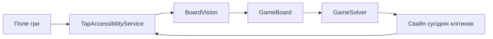

# Архітектура

## Потік одного ходу

Служба робить кадр через Android Accessibility API, перевіряє стабільність поля, передає його розпізнавачу, отримує оцінений хід і відправляє свайп. Після короткого очікування цикл повторюється. Android обмежує частоту знімків; сервіс не запитує кадр частіше ніж приблизно раз на 334 мс.

## Основні класи

- `TapAccessibilityService` керує плаваючою панеллю, життєвим циклом автоматичної гри, знімками екрана, повторним читанням нестабільного поля та свайпом.
- `BoardVision` вибирає 64 області з кадру за каліброваними координатами, аналізує колір у кожній та відхиляє низьконадійне розпізнавання.
- `GameBoard` зберігає незмінний стан поля 8×8: сім типів кольорових самоцвітів і три спеціальні фішки.
- `GameSolver` перебирає обміни сусідніх клітинок, знаходить збіги й оцінює спеціальні фішки, каскади та ймовірні поповнення.
- `MainActivity` містить екран запуску та веде до налаштувань доступності.

## Розпізнавання

Координати клітинок обчислюються як частки ширини й висоти кадру та прив’язані до одного портретного розташування поля. У кожній клітинці перевіряється сітка зразків кольору. Якщо відтінок, частка голосів або відрив від другого кандидата не проходять поріг упевненості, кадр відхиляється, і служба повторює знімок.

Кольорові самоцвіти класифікуються за HSV-відтінком. Спецфішки впізнаються за характерними ділянками кольорів: червоно-жовтий візерунок ракети, нейтрально-темний візерунок бомби й різнокольоровий візерунок порталу-вихору.

## Оцінювання ходів

Поле 8×8 має 112 пар сусідніх клітинок. Для кожної пари розв’язувач моделює обмін. Звичайний обмін враховується, якщо він створює збіг; обмін зі спецфішкою оцінюється як активація цієї фішки.

Поточна логіка створення бонусів моделює:

- 4 або більше фішок у лінії — ракету;
- збіг із перетином та компонентом щонайменше з 5 фішок — бомбу;
- лінію щонайменше з 5 фішок — портал-вихор.

Бомба очищає область навколо себе, ракета — ряд або стовпець, портал-вихор — фішки одного кольору. Зачеплені спецфішки активуються ланцюжком у симуляції. Напрямок смуги ракети з кадру не визначається, тому оцінювач моделює його випадково.

Базова вага — 50 очок за прибраний самоцвіт при множнику ×1. Вона відкалібрована за спостереженими повідомленнями гри (200 за 4, 250 за 5, 500 за 10). Поточні каскади симулюються до п’яти кроків зі спадною вагою. Для трьох найкращих початкових ходів генеруються випадкові варіанти поповнення; коли оцінки двох найкращих ходів близькі, для них додаються додаткові зразки. Ці оцінки допомагають ранжувати ходи, але не є точним прогнозом рахунку.

## Залежності та дані

Застосунок реалізовано на Java 17 із Android SDK. Додаткових бібліотек розпізнавання зображень або мережевих SDK немає. Кадр копіюється в пам’ять для розбору; код не зберігає скриншоти й не надсилає їх назовні. У маніфесті застосунку немає дозволу `INTERNET`.

## Межі сумісності

Геометрія й палітра налаштовані під показаний портретний інтерфейс Backpack Blitz. Інша роздільність зазвичай масштабується через відносні координати, але зміщення поля, інша рамка, тема чи зміна оформлення фішок можуть призвести до помилок розпізнавання. Android 11+ потрібен для API знімків екрана AccessibilityService, хоча `minSdk` пакета нижчий.
