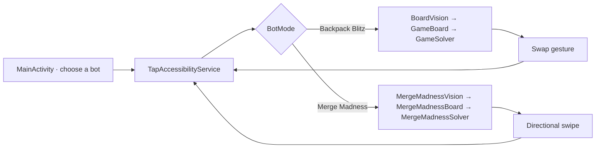

# Architecture

## One-move flow

The service captures a frame through the Android Accessibility API, checks board
stability, sends the frame to a recognizer, receives a move estimate, and
dispatches a swipe. The cycle repeats after a short wait. Android limits
screenshot frequency; the service does not request frames more often than about
once every 334 ms.

## Main classes

- `MainActivity` builds collapsed cards and available settings from
  `ClickerCatalog`, and links to Android permissions.
- `BotMode` contains stable engine keys. `ClickerModule` describes a name, icon,
  palette, and settings; `ClickerCatalog` is the single source for these entries.
- `ClickerPreferences` stores independent timeouts and panel profiles.
  `ExpandableSection` provides shared collapsed-section behavior. See
  [MODULES.md](MODULES.md).
- `TapAccessibilityService` manages the floating panel, frames, board
  stabilization, retries after unchanged swipes, and gesture execution.
- `BoardVision`, `GameBoard`, and `GameSolver` handle the 8×8 Backpack Blitz board.
- `MergeMadnessVision`, `MergeMadnessBoard`, and `MergeMadnessSolver` handle the
  4×4 Merge Madness board.

## Recognition

Backpack Blitz board coordinates are fractions of frame width and height,
calibrated for one portrait layout. A color-sample grid is checked in every cell.
If hue, vote share, or the margin over the second candidate misses the
confidence threshold, the frame is rejected and the service captures another.

For the 2048 board, the locator checks the full supported vertical range of the
square 4×4 grid on every frame. Required column gradients are computed once per
frame and reused for all candidates. Board geometry anchors cell reads and the
four rows of five hints below the board. An object's position in the sequence
determines its rank. The game has 15 ranks; the reader can technically hold 17
positions. That is implementation headroom, not a confirmed game count. Open,
colored icons automatically become current samples; the next level's black
silhouette is not used as a colored-object sample. Hint-pixel or geometry
changes reset the relevant cache. A newly revealed object is read on the next
frame.

`MergeMadnessObjects` compares object contours and color features. Samples from
`res/raw` and previously saved local samples remain fallback sources. A
high-confidence direct sample is protected from a weaker conflicting hint.
Uncertain cells trigger another frame read. Manual calibration buttons were
removed from the panel; saved recognition data is still read as before.

Colored gems are classified by HSV hue. Special tiles use characteristic color
regions: the red/yellow rocket pattern, neutral dark bomb pattern, and
multicolored portal/whirlwind pattern.

## Move scoring

An 8×8 board has 112 adjacent-cell pairs. The solver simulates each swap.
Regular swaps count if they create a match; swapping with a special tile is
scored as activating that tile.

Current bonus creation rules model:

- 4 or more tiles in a line: a rocket;
- an intersecting match with a connected component of at least 5 tiles: a bomb;
- a line of at least 5 tiles: a portal/whirlwind.

A bomb clears its surrounding area, a rocket clears a row or column, and a
portal/whirlwind clears tiles of one color. Hit special tiles activate in a
chain in the simulation. Rocket stripe direction is not read from the frame,
so the evaluator models it randomly.

The base weight is 50 points per cleared gem at a ×1 multiplier. It is calibrated
from observed game messages (200 for 4, 250 for 5, 500 for 10). Current cascades
are simulated up to five steps with decreasing weight. Random refills are
generated for the three top initial moves; extra samples are added when the two
best scores are close. These estimates rank moves but do not predict the actual
score exactly.

## Merge Madness

`MergeMadnessBoard` supports up to 17 ranks technically (the game's actual target
is 15) and models four directions. It compresses tiles toward an edge and merges
equal ranks at most once per move. The immutable-board hash is computed on
creation; available directions are found without building four swipe results.

An initial or uncertain board is read twice. After a swipe, one read is allowed
if `MergeMadnessTurnPolicy` confirms an exact transition with one new tile,
stable geometry, confidence of at least 0.82, and at least 180 ms since the
gesture ended. Transition checks and learning the spawn model are retained.

`MergeMadnessSolver` runs expectimax to depth 3 with a 120 ms budget, caches
states, and completes search levels incrementally. The initial 90% / 10% tile
spawn model is refined during the current run only from confirmed transitions.
The evaluation considers free cells, merges, available directions, ordering,
and the corner with the largest tile. Timing and equivalence comparisons are in
[VERIFICATION-1.9.35.md](VERIFICATION-1.9.35.md). Earlier 600-move comparisons
covered early and mid-game; rank-15 testing and its limitations are in
[ALGORITHMS-LEVEL15.md](ALGORITHMS-LEVEL15.md).

## Panel and module configuration

The shared panel has a compact state, expanded diagnostics, and an icon state.
Collapsing to the icon does not stop a session; closing the panel does. Opening
another module stops the previous one. One service and one work queue serve the
current session. Panel position and width are stored per module. Since 1.9.42,
timers use an independent `TimerOverlay` window with its own position profiles;
opening it does not switch the bot session.

The timeout setting migrates from the old shared value and is then stored
independently. Panel styling does not change search depth, recognition
confidence, or screenshot intervals. See [MODULES.md](MODULES.md) for current
modularity boundaries and future session adapters.

## Interface language

`AppLanguage` stores the explicit `uk` / `cs` choice in
`pelyustka_locale/language`. `LocalizedActivity` applies the language
configuration to app screens and system dialogs. UI strings are in
`values/strings.xml` (Ukrainian) and `values-cs/strings.xml` (Czech); module
counts use Android `plurals`. Accessibility windows and notification receivers
get the selected language through `AppLanguage`, regardless of the phone's
language. Recognition mechanisms retain their original diagnostic messages;
the presentation layer translates them. Details: [LOCALIZATION-1.9.43.md](LOCALIZATION-1.9.43.md).

## Dependencies and data

The app is written in Java 17 with the Android SDK. It has no additional image
recognition or networking SDKs. A frame is copied into memory for processing;
the code does not save screenshots or send them elsewhere. The tile-rank
reference table is a local app resource. The manifest has no `INTERNET`
permission.

## Compatibility limits

Backpack Blitz uses coordinates for the shown portrait layout. Merge Madness
allows moderate board-boundary shifts; a different frame, theme, or tile design
may cause recognition errors. Android 11+ is required for the
AccessibilityService screenshot API even though the package `minSdk` is lower.

## Local reminder timers

- `TimerPresets` adds four stopped reward definitions once; existing custom
  timers are retained. Deleted presets can be restored explicitly.
- `TimerActivity` creates and edits timers, starts, restarts, and stops them, and
  accepts a one-time remaining time from the game. Editing an interval preserves
  the current countdown unless the user chooses to restart it.
- `TimerItem` separates a definition from a running instance. `TimerCodec` reads
  old JSON and stores new fields under the same `reminder_timers_v1` key.
- `TimerStore` saves a monotonic deadline, fallback wall-clock time, Android
  boot count, and unique run token. Changing the clock does not alter remaining
  time during the same boot; after reboot, remaining time is calculated from the
  fallback clock. APK updates do not restart countdowns.
- `TimerOverlay` is a second `TYPE_ACCESSIBILITY_OVERLAY` window, independent of
  the bot panel. It has its own list, icon, positions, and once-per-second
  refresh. Closing the window stops neither timers nor the bot.
- `TimerNotificationReceiver` sends one notification per run, checks tokens,
  and rejects stale actions. The notification offers restart after claiming a
  reward and stop. Without notification permission, a run is not marked notified.
- `TimerBootReceiver` handles reboot, APK replacement, system-time changes, and
  exact-alarm permission grants. `AlarmManager` uses
  `ELAPSED_REALTIME_WAKEUP`: an exact alarm when allowed, otherwise an inexact
  one. The UI does not keep a background service alive just for countdowns.
- Timers receive no game data. The user enters an interval or remaining time;
  watching ads and claiming rewards remain manual. Android settings and limits:
  [TIMERS-1.9.42.md](TIMERS-1.9.42.md).
