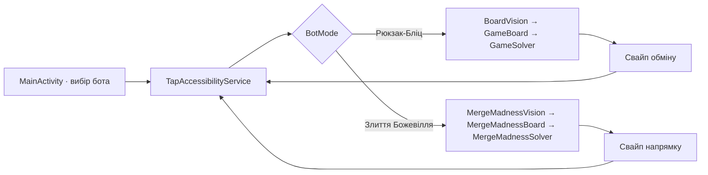

# Архітектура

## Потік одного ходу

Служба робить кадр через Android Accessibility API, перевіряє стабільність поля, передає його розпізнавачу, отримує оцінений хід і відправляє свайп. Після короткого очікування цикл повторюється. Android обмежує частоту знімків; сервіс не запитує кадр частіше ніж приблизно раз на 334 мс.

## Основні класи

- `MainActivity` формує згорнуті картки та доступні налаштування з `ClickerCatalog` і веде до дозволів Android.
- `BotMode` містить сталі ключі рушіїв. `ClickerModule` описує назву, іконку, палітру й набір параметрів; `ClickerCatalog` є єдиним джерелом цих описів.
- `ClickerPreferences` зберігає незалежні таймаути та профілі панелі. `ExpandableSection` надає спільну поведінку згорнутих розділів. Докладніше: [MODULES.md](MODULES.md).
- `TapAccessibilityService` керує плаваючою панеллю, кадрами, стабілізацією поля, повтором незміненого свайпу й виконанням жестів.
- `BoardVision`, `GameBoard` і `GameSolver` працюють із полем 8×8 «Рюкзак-Бліц».
- `MergeMadnessVision`, `MergeMadnessBoard` і `MergeMadnessSolver` працюють із полем 4×4 «Злиття Божевілля».

## Розпізнавання

Координати поля «Рюкзак-Бліц» обчислюються як частки ширини й висоти кадру та прив’язані до одного портретного розташування. У кожній клітинці перевіряється сітка зразків кольору. Якщо відтінок, частка голосів або відрив від другого кандидата не проходять поріг упевненості, кадр відхиляється, і служба повторює знімок.

Для 2048-поля локатор на кожному кадрі перевіряє весь дозволений діапазон
вертикального положення квадратної сітки 4×4. Градієнти потрібних колонок
обчислюються один раз на кадр для всіх кандидатів. Геометрія поля прив'язує
читання клітинок і до чотирьох рядків нижніх підказок по п'ять позицій.
Положення об'єкта в послідовності визначає його рівень. За уточненням
користувача, гра має 15 рівнів; технічна місткість читача — 17 позицій.
Це запас реалізації, а не підтверджена кількість об'єктів гри. Кольорові відкриті
іконки автоматично стають поточними зразками; чорний силует наступного рівня
не використовується як кольоровий об'єкт. Зміни пікселів підказок або геометрії
скидають відповідний кеш. Новий об'єкт зчитується на наступному кадрі.

`MergeMadnessObjects` зіставляє контур і кольорові ознаки об'єктів. Зразки з
`res/raw` та раніше збережені локальні зразки лишаються резервним джерелом.
Висока впевненість прямого зразка захищається від слабшої суперечливої
підказки. Невпевнені клітинки спричиняють повторне читання кадру. Ручні
кнопки калібрування прибрані з панелі; збережені дані розпізнавання читаються
як раніше.

Кольорові самоцвіти класифікуються за HSV-відтінком. Спецфішки впізнаються за характерними ділянками кольорів: червоно-жовтий візерунок ракети, нейтрально-темний візерунок бомби й різнокольоровий візерунок порталу-вихору.

## Оцінювання ходів

Поле 8×8 має 112 пар сусідніх клітинок. Для кожної пари розв’язувач моделює обмін. Звичайний обмін враховується, якщо він створює збіг; обмін зі спецфішкою оцінюється як активація цієї фішки.

Поточна логіка створення бонусів моделює:

- 4 або більше фішок у лінії — ракету;
- збіг із перетином та компонентом щонайменше з 5 фішок — бомбу;
- лінію щонайменше з 5 фішок — портал-вихор.

Бомба очищає область навколо себе, ракета — ряд або стовпець, портал-вихор — фішки одного кольору. Зачеплені спецфішки активуються ланцюжком у симуляції. Напрямок смуги ракети з кадру не визначається, тому оцінювач моделює його випадково.

Базова вага — 50 очок за прибраний самоцвіт при множнику ×1. Вона відкалібрована за спостереженими повідомленнями гри (200 за 4, 250 за 5, 500 за 10). Поточні каскади симулюються до п’яти кроків зі спадною вагою. Для трьох найкращих початкових ходів генеруються випадкові варіанти поповнення; коли оцінки двох найкращих ходів близькі, для них додаються додаткові зразки. Ці оцінки допомагають ранжувати ходи, але не є точним прогнозом рахунку.

## «Злиття Божевілля»

`MergeMadnessBoard` має технічну місткість до 17 рангів (фактична ціль гри — 15)
і моделює чотири напрямки:
стискає плитки до краю та об'єднує однакові ранги один раз за хід. Хеш
незмінного поля обчислюється при створенні; доступні напрямки визначаються
без створення чотирьох результатів свайпу.

Початкове або непевне поле проходить два читання. Після виконаного свайпу
дозволене одне читання, якщо `MergeMadnessTurnPolicy` підтверджує точний
перехід з однією новою плиткою, стабільну геометрію, впевненість від 0.82 і
щонайменше 180 мс після завершення жесту. Перевірка переходу й навчання
моделі появи плиток зберігаються.

`MergeMadnessSolver` виконує expectimax до глибини 3 із бюджетом 120 мс,
кешує стани й поступово завершує рівні пошуку. Початкова модель появи плиток
90% / 10% уточнюється в межах поточного запуску лише за підтвердженими
переходами. Оцінка враховує вільні клітинки, об'єднання, доступні напрямки,
впорядкованість і кут із найбільшою плиткою. Заміри та порівняння еквівалентності
наведені в [VERIFICATION-1.9.35.md](VERIFICATION-1.9.35.md).
Попередні 600-ходові порівняння охоплювали ранню й середню гру;
перевірка цілі 15 та її обмеження описані в [ALGORITHMS-LEVEL15.md](ALGORITHMS-LEVEL15.md).

## Панель і модульна конфігурація

Спільна панель має компактний вигляд, розгорнуту діагностику та іконку.
Згортання до іконки не зупиняє сесію; закриття панелі зупиняє. Відкриття
іншого модуля зупиняє попередній. Одна служба й одна черга обчислень
обслуговують поточну сесію. Положення й ширина панелі зберігаються у профілі
модуля. Таймери від 1.9.42 мають незалежне вікно `TimerOverlay` із власними
профілями положення; відкриття цього вікна не перемикає сесію бота.

Налаштування таймауту мігрують зі старого спільного значення та надалі
зберігаються незалежно. Глибина пошуку, впевненість розпізнавання й інтервали
знімків не змінюються через оформлення панелі. Межа поточної модульності та
подальше виділення адаптерів сесій описані в [MODULES.md](MODULES.md).

## Залежності та дані

Застосунок реалізовано на Java 17 із Android SDK. Додаткових бібліотек розпізнавання зображень або мережевих SDK немає. Кадр копіюється в пам’ять для розбору; код не зберігає скриншоти й не надсилає їх назовні. Довідкова таблиця рівнів плиток є локальним ресурсом застосунку. У маніфесті немає дозволу `INTERNET`.

## Межі сумісності

«Рюкзак-Бліц» використовує координати показаного портретного розташування. Для «Злиття Божевілля» пошук меж допускає помірний зсув поля; інша рамка, тема або зміна оформлення плиток можуть призвести до помилок розпізнавання. Android 11+ потрібен для API знімків екрана AccessibilityService, хоча `minSdk` пакета нижчий.
## Локальні таймери нагадувань

- `TimerPresets` додає чотири зупинені визначення нагород один раз; чинні користувацькі таймери зберігаються. Видалені визначення можна повернути явною дією.
- `TimerActivity` дозволяє створювати й редагувати таймери, запускати, перезапускати, зупиняти та задавати одноразовий залишок із гри. Редагування інтервалу зберігає чинний відлік, якщо користувач не обрав перезапуск.
- `TimerItem` відокремлює визначення від запуску. `TimerCodec` читає попередній JSON та зберігає нові поля в тому самому ключі `reminder_timers_v1`.
- `TimerStore` зберігає монотонний дедлайн, резервний час завершення, номер завантаження Android і унікальний токен запуску. Зміна годинника не змінює залишок у межах завантаження; після перезавантаження залишок обчислюється за резервним часом. Оновлення APK не перезапускає відлік.
- `TimerOverlay` — друге вікно `TYPE_ACCESSIBILITY_OVERLAY`, незалежне від панелі бота. Має власний список, іконку, позиції та оновлення раз на секунду. Закриття вікна не зупиняє таймери чи бота.
- `TimerNotificationReceiver` доставляє одне сповіщення на запуск, перевіряє токен і відхиляє застарілі дії. Сповіщення містить перезапуск після отримання нагороди та зупинку. Без дозволу недоставлений запуск не позначається сповіщеним.
- `TimerBootReceiver` обробляє перезавантаження, заміну APK, зміну системного часу та надання точних будильників. `AlarmManager` використовує `ELAPSED_REALTIME_WAKEUP`: точний будильник за наявності доступу, неточний — без нього. UI не тримає фонову службу лише заради відліку.
- Таймери не отримують дані з гри. Інтервал або залишок вводить користувач; реклама й отримання нагороди залишаються ручними. Налаштування та обмеження Android: [TIMERS-1.9.42.md](TIMERS-1.9.42.md).
