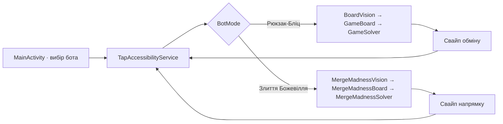

# Архітектура

## Потік одного ходу

Служба робить кадр через Android Accessibility API, перевіряє стабільність поля, передає його розпізнавачу, отримує оцінений хід і відправляє свайп. Після короткого очікування цикл повторюється. Android обмежує частоту знімків; сервіс не запитує кадр частіше ніж приблизно раз на 334 мс.

## Основні класи

- `MainActivity` показує окремі кнопки для кожного бота й веде до налаштувань доступності.
- `BotMode` вибирає незалежний розпізнавач, модель поля й розв’язувач у спільній службі доступності.
- `TapAccessibilityService` керує плаваючою панеллю, кадрами, стабілізацією поля, повтором незміненого свайпу й виконанням жестів.
- `BoardVision`, `GameBoard` і `GameSolver` працюють із полем 8×8 «Рюкзак-Бліц».
- `MergeMadnessVision`, `MergeMadnessBoard` і `MergeMadnessSolver` працюють із полем 4×4 «Злиття Божевілля».

## Розпізнавання

Координати поля «Рюкзак-Бліц» обчислюються як частки ширини й висоти кадру та прив’язані до одного портретного розташування. У кожній клітинці перевіряється сітка зразків кольору. Якщо відтінок, частка голосів або відрив від другого кандидата не проходять поріг упевненості, кадр відхиляється, і служба повторює знімок.

Для 2048-поля служба шукає повторювані горизонтальні й вертикальні межі сітки 4×4. Якщо локальний пошук не підтверджує попередню позицію, служба знаходить сітку по всьому кадру. Центри клітинок і рядки ланцюжка злиття внизу обчислюються від знайденої сітки, тому рухаються разом із полем. Локатор відстежує до чотирьох рядків і 17 рівнів, зокрема новий рядок після перенесення ланцюжка; діагностика показує зсув поля, видимі рядки та впевненість розпізнавання. Користувач може намалювати рамку сітки 4×4 як початковий геометричний орієнтир або повернути автоматичний пошук. Іконку миші з нижнього ланцюжка можна зберегти як зразок вибраного рівня; зразки зберігаються локально в налаштуваннях застосунку. Яскравість кутів кожної клітинки відрізняє порожнє місце від плитки. Класифікатор звіряє плитки зі зразками з `res/raw/merge_madness_guide.jpg`, зображеннями реальних плиток і зразками користувача. Коли звичайне зіставлення має низьку впевненість, іконки ланцюжка можуть підтвердити рівні 1–7. Нерозбірливі кадри відхиляються, а не перетворюються на хибний хід.

Кольорові самоцвіти класифікуються за HSV-відтінком. Спецфішки впізнаються за характерними ділянками кольорів: червоно-жовтий візерунок ракети, нейтрально-темний візерунок бомби й різнокольоровий візерунок порталу-вихору.

## Оцінювання ходів

Поле 8×8 має 112 пар сусідніх клітинок. Для кожної пари розв’язувач моделює обмін. Звичайний обмін враховується, якщо він створює збіг; обмін зі спецфішкою оцінюється як активація цієї фішки.

Поточна логіка створення бонусів моделює:

- 4 або більше фішок у лінії — ракету;
- збіг із перетином та компонентом щонайменше з 5 фішок — бомбу;
- лінію щонайменше з 5 фішок — портал-вихор.

Бомба очищає область навколо себе, ракета — ряд або стовпець, портал-вихор — фішки одного кольору. Зачеплені спецфішки активуються ланцюжком у симуляції. Напрямок смуги ракети з кадру не визначається, тому оцінювач моделює його випадково.

Базова вага — 50 очок за прибраний самоцвіт при множнику ×1. Вона відкалібрована за спостереженими повідомленнями гри (200 за 4, 250 за 5, 500 за 10). Поточні каскади симулюються до п’яти кроків зі спадною вагою. Для трьох найкращих початкових ходів генеруються випадкові варіанти поповнення; коли оцінки двох найкращих ходів близькі, для них додаються додаткові зразки. Ці оцінки допомагають ранжувати ходи, але не є точним прогнозом рахунку.

## «Злиття Божевілля»

`MergeMadnessBoard` зберігає до 17 рангів плиток і моделює чотири напрямки свайпу: спочатку стискає плитки до краю, потім об’єднує сусідні однакові ранги один раз за хід. Перед вибором напряму служба чекає два послідовні кадри зі стабільним полем і геометрією. Після свайпу перевіряє перехід; статистику появи оновлює лише для підтвердженого ходу з одним злиттям і новою плиткою рівня 1 або 2. `MergeMadnessSolver` шукає до трьох ходів наперед, кешує стани й обмежує обчислення 120 мс (менше за встановлену межу 200 мс). Надана інструкція не вказує частоту появи плиток, тому модель починає з припущення 90% / 10% і навчається лише в межах поточного запуску. Оцінка насамперед бере до уваги вільні клітинки, доступні об’єднання й кут із найбільшою плиткою; очки мають меншу вагу. Це евристика для вибору напрямку, а не гарантія найвищого результату.

## Залежності та дані

Застосунок реалізовано на Java 17 із Android SDK. Додаткових бібліотек розпізнавання зображень або мережевих SDK немає. Кадр копіюється в пам’ять для розбору; код не зберігає скриншоти й не надсилає їх назовні. Довідкова таблиця рівнів плиток є локальним ресурсом застосунку. У маніфесті немає дозволу `INTERNET`.

## Межі сумісності

«Рюкзак-Бліц» використовує координати показаного портретного розташування. Для «Злиття Божевілля» пошук меж допускає помірний зсув поля; інша рамка, тема або зміна оформлення плиток можуть призвести до помилок розпізнавання. Android 11+ потрібен для API знімків екрана AccessibilityService, хоча `minSdk` пакета нижчий.
# Локальні таймери нагадувань

- `TimerActivity` створює таймери з назвою, емодзі та тривалістю. Новий відлік починається одразу після створення; повторний старт після ігрової дії виконується вручну.
- `TimerStore` зберігає список, монотонний дедлайн і резервний час завершення в `SharedPreferences`. Відлік не залежить від зміни часової зони чи частоти оновлення інтерфейсу; після перезавантаження таймери відновлюються за резервним часом пристрою.
- `TapAccessibilityService` показує таймери в окремому режимі плаваючої панелі, який відкривається з екрана таймерів; коли панель згорнута, залишає на ній назву й час найближчого таймера. Кнопка готового таймера перезапускає його збережену тривалість.
- `TimerNotificationReceiver` показує локальне Android-сповіщення, а `TimerBootReceiver` відновлює заплановані сповіщення після перезавантаження пристрою. Android може відкласти сповіщення через енергозбереження.
- Таймери не отримують дані з гри та не читають/не змінюють її файли, мережу чи стан екрана. Тривалість вводить користувач.
