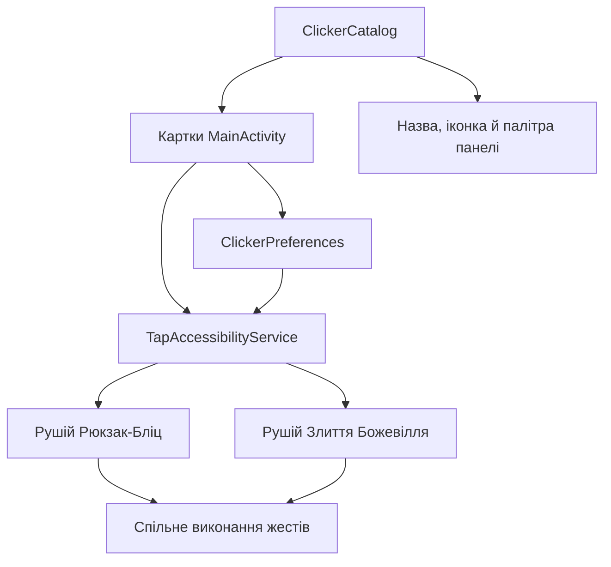

# Модулі клікерів

Стан реалізації: **1.9.37**. Каталог, картки, налаштування й плаваюча панель
спільні. Два наявні ігрові рушії зберігають свої моделі, розпізнавачі та оцінювачі.

## Підключені модулі

| Сталий ID | Назва | Рушій |
| --- | --- | --- |
| `backpack_blitz` | Рюкзак-Бліц | `BoardVision`, `GameBoard`, `GameSolver` |
| `merge_madness` | Злиття Божевілля | `MergeMadnessVision`, `MergeMadnessBoard`, `MergeMadnessSolver` |

## Структура

| Клас | Відповідальність |
| --- | --- |
| `BotMode` | Сталі ключі підтримуваних рушіїв; порядок enum не використовується в збережених даних |
| `ClickerModule` | Незмінний опис модуля: ID, назва, іконка, опис, формат поля, палітра та перелік налаштувань |
| `ClickerCatalog` | Єдиний впорядкований каталог; перевіряє унікальність ID і наявність опису для кожного рушія |
| `ClickerPreferences` | Налаштування модуля, міграція старого таймауту та профілі панелі |
| `ExpandableSection` | Спільна поведінка спойлера, клавіатурного фокуса й дій доступності |
| `MainActivity` | Будує картки й доступні елементи налаштування з каталогу |
| `TapAccessibilityService` | Одна активна сесія, спільне захоплення екрана, виконання жестів, панель та маршрутизація до наявних рушіїв |

Це каталог вбудованих модулів, які постачаються з APK. Окремого завантаження
виконуваних плагінів у цій версії немає.

## Опис і налаштування

У `ClickerCatalog` створюється `ClickerModule` із ключем `BotMode`, назвою,
іконкою, описом, форматом поля, палітрою `Theme` та набором `Setting`.
Головний екран перебирає `ClickerCatalog.all()`; картка й лічильник модулів
оновлюються без додаткової верстки для конкретної гри.

Доступні параметри схеми:

- `NO_CHANGE_TIMEOUT`: очікування повторної спроби після незміненого поля,
  400–4000 мс із кроком 100 мс. Після успішного ходу цей час не додається.
- `PANEL_WIDTH`: ширина панелі 224–360 dp із кроком 8 dp, початково 272 dp.
  Фактична ширина обмежується доступною областю екрана.

Набір параметрів задає сам запис модуля. Новий тип параметра потребує окремого
елемента схеми й спільного віджета; це не вимагає копіювання всієї картки.

## Збереження даних

Новий файл `SharedPreferences`: `pelyustka_modules`.

| Ключ | Значення |
| --- | --- |
| `module.<id>.timeout_ms` | Незалежний таймаут модуля |
| `panel.<id>.width_dp` | Ширина панелі модуля |
| `panel.<id>.details` | Розгорнутість діагностики |
| `panel.<id>.<orientation>.x` / `.y` | Відносне положення в доступній області |

`orientation` має значення `portrait` або `landscape`. Відносні координати
зберігаються в межах 0–1 з урахуванням розміру панелі. Під час відновлення
враховуються системні панелі й виріз екрана; після зміни висоти панель
утримується у доступній області. Профілі `timers` і `timers_bubble` зарезервовані
для окремого вікна нагадувань та його іконки. Вони не перемикають активний бот.
Ширина спільна для двох орієнтацій конкретного модуля; положення окреме.
Висота визначається вмістом. Згортання до іконки діє до наступного відкриття
модуля через головний екран.

Коли `module.<id>.timeout_ms` ще відсутній, значення один раз копіюється зі
старого `pelyustka_settings/move_delay_ms`, з тими самими межами. Після цього
модулі налаштовуються незалежно. Старий ключ лишається джерелом міграції.
Дані зразків розпізнавання не змінюються. Таймери зберігають старий ключ даних;
міграція нових полів описана в [TIMERS-1.9.42.md](TIMERS-1.9.42.md).

## Поточна межа модульності

Розпізнавання й пошук ходів уже знаходяться в окремих класах кожної гри.
Життєвий цикл двох різних полів ще маршрутизується всередині
`TapAccessibilityService` через `BotMode`: типізовані результати, перевірка
стабільності та діагностичні сітки відрізняються. Цей етап не переносить їх
у новий універсальний рушій і не змінює ігрові правила.

Перед третім типом гри варто винести цю маршрутизацію в адаптери сесій із
єдиними операціями запуску, зупинки, читання кадру й формування діагностики.
Контракт слід визначити за вимогами нового клікера; приклади — у
[ROADMAP.md](ROADMAP.md).

## Додавання нового модуля

1. Визначити поведінку, очікувані екрани, допустимі дії й умови зупинки.
2. Додати сталий ID у `BotMode`; ID не змінювати після випуску й не
   використовувати `timers` чи `timers_bubble`.
3. Зареєструвати опис, палітру та підтримувані параметри у `ClickerCatalog`.
4. Реалізувати окремі класи розпізнавання/стану/вибору дії. Якщо потрібен інший
   життєвий цикл, спочатку виділити адаптер сесії зі спільної служби.
5. Підключити виконання й діагностику через спільну службу. Знімання екрана,
   черга жестів і правило однієї активної сесії залишаються спільними.
6. Додати специфічні параметри в схему, описати їхні одиниці, межі й міграцію.
7. Оновити документацію модуля й випустити APK зі збереженим ключем.

Ідеї модулів не додаються в робочий каталог до реалізації їхньої поведінки.
