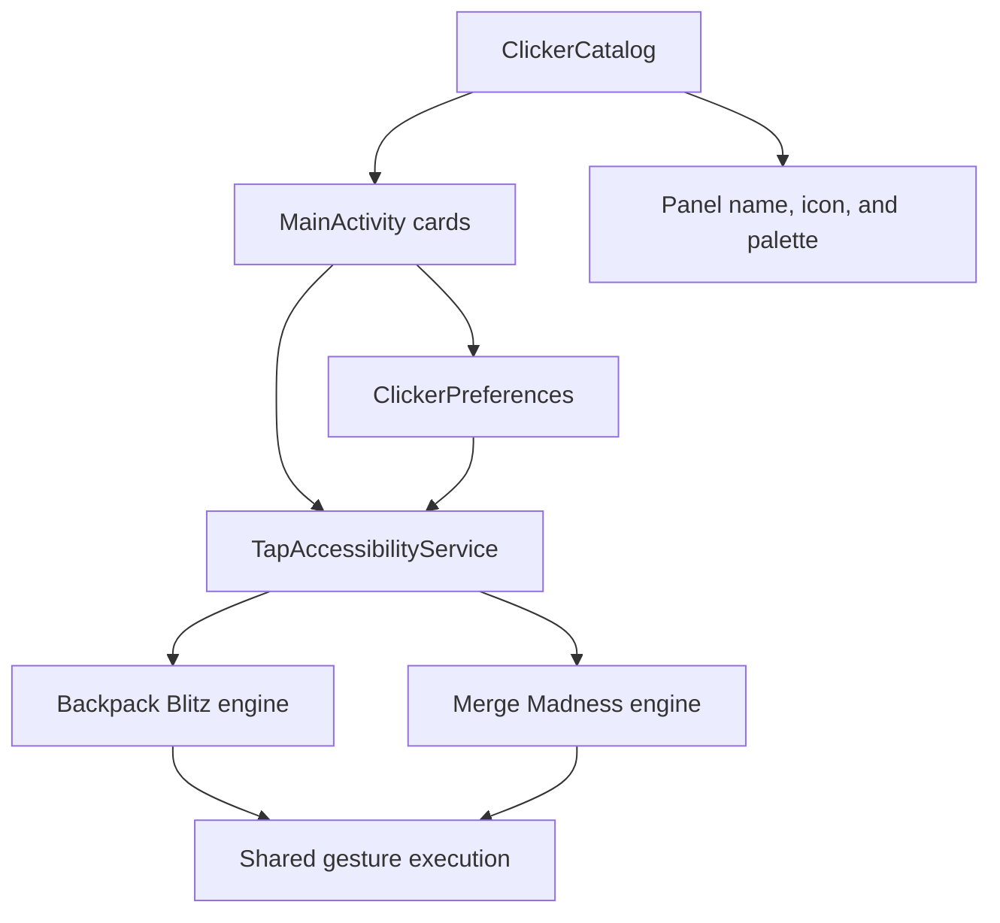

# Clicker modules

The catalog was introduced in **1.9.37** and localized in **1.9.43**. The
catalog, cards, settings, and floating panel are shared. The two existing game
engines retain their own board models, recognizers, and evaluators.

## Registered modules

| Stable ID | Name | Engine |
| --- | --- | --- |
| `backpack_blitz` | Backpack Blitz | `BoardVision`, `GameBoard`, `GameSolver` |
| `merge_madness` | Merge Madness | `MergeMadnessVision`, `MergeMadnessBoard`, `MergeMadnessSolver` |

## Structure

| Class | Responsibility |
| --- | --- |
| `BotMode` | Stable keys for supported engines; enum order is not used in saved data |
| `ClickerModule` | Immutable module description: ID, name, icon, description, board format, palette, and settings |
| `ClickerCatalog` | One ordered catalog; checks unique IDs and a description for every engine |
| `ClickerPreferences` | Module settings, old-timeout migration, and panel profiles |
| `ExpandableSection` | Shared expandable-section behavior, keyboard focus, and accessibility actions |
| `MainActivity` | Builds cards and available settings from the catalog |
| `TapAccessibilityService` | One active session, shared screenshot capture and gesture execution, panel, and routing to existing engines |

This is a catalog of built-in modules shipped in the APK. This version does not
support separately downloaded executable plugins.

## Descriptions and settings

`ClickerCatalog` creates `ClickerModule` entries with a `BotMode` key, name
resource, icon, description resource, board format, `Theme` palette, and set of
`Setting` values. `nameRes` and `descriptionRes` are `R.string` IDs; their values
are resolved while building the UI using the selected language. The main screen
iterates over `ClickerCatalog.all()`. Cards and the module count update without
game-specific layouts.

Supported setting schemas:

- `NO_CHANGE_TIMEOUT`: delay before retrying an unchanged board, 400–4000 ms in
  100 ms steps. This delay is not added after a successful move.
- `PANEL_WIDTH`: panel width from 224–360 dp in 8 dp steps, 272 dp by default.
  The actual width is limited by the available screen area.

Each module entry declares its own settings. A new setting type requires a
schema entry and shared widget, not a copied card implementation.

## Saved data

New `SharedPreferences` file: `pelyustka_modules`.

| Key | Value |
| --- | --- |
| `module.<id>.timeout_ms` | Per-module timeout |
| `panel.<id>.width_dp` | Per-module panel width |
| `panel.<id>.details` | Whether diagnostics are expanded |
| `panel.<id>.<orientation>.x` / `.y` | Relative position within the available area |

`orientation` is `portrait` or `landscape`. Relative coordinates are saved from
0 to 1 and account for panel size. Restoration accounts for system bars and
display cutouts; after a height change, the panel is kept within the usable area.
The `timers` and `timers_bubble` profiles are reserved for the separate reminder
window and its icon. They do not switch the active bot. Width is shared between
orientations for a module; position is stored separately. Height follows the
content. Collapsing to an icon lasts until the next module is opened from the
main screen.

If `module.<id>.timeout_ms` is missing, it is copied once from the old
`pelyustka_settings/move_delay_ms`, using the same bounds. Modules are then
configured independently. The old key remains as the migration source.
Recognition samples are unchanged. Timers retain their previous data key; see
[TIMERS-1.9.42.md](TIMERS-1.9.42.md) for migration of their new fields.

## Current modularity boundary

Recognition and move search are already in separate classes for each game.
The lifecycle for the two different boards is still routed inside
`TapAccessibilityService` through `BotMode`: typed results, stability checks,
and diagnostic grids differ. This stage does not move them to a new universal
engine or change game rules.

Before adding a third game type, consider moving this routing into session
adapters with shared start, stop, frame-reading, and diagnostics operations.
Define the contract from the new clicker's needs; examples are in [ROADMAP.md](ROADMAP.md).

## Adding a module

1. Define the behavior, expected screens, allowed actions, and stop conditions.
2. Add a stable ID to `BotMode`; do not change it after release or use
   `timers` / `timers_bubble`.
3. Register the description, palette, and supported settings in
   `ClickerCatalog`. Add the name and description to `values/strings.xml` and
   `values-cs/strings.xml`.
4. Implement separate recognition, state, and action-selection classes. If a
   different lifecycle is needed, first extract a session adapter from the
   shared service.
5. Connect execution and diagnostics through the shared service. Screenshot
   capture, gesture queue, and the one-active-session rule remain shared.
6. Add module-specific settings to the schema and document their units, bounds,
   and migration.
7. Update the module documentation and build an APK with the saved signing key.

Module ideas do not enter the working catalog until their behavior is implemented.
